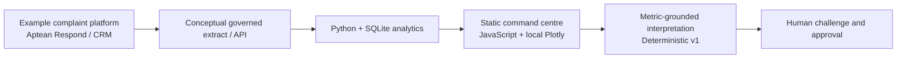

# Financial Services Remediation Analytics & Command Centre

A portfolio prototype by **Gurjit Kaila** demonstrating business analysis, data analysis and governed AI transformation through a fictional UK financial-services remediation programme.

**Synthetic data only. No live Aptean Respond API connection. No production deployment or enterprise implementation is claimed.** Aptean Respond is an example upstream complaint-management platform in a conceptual architecture; this project is not affiliated with or endorsed by Aptean.

**[Explore the live demo on Render](https://gurjit-remediation-command-centre.onrender.com/)** · **[Aptean Respond integration walkthrough](https://gurjit-remediation-command-centre.onrender.com/respond-integration.html)** · [GitHub source](https://github.com/gurj86/remediation-command-centre)

Hosted publicly on Render as a static site. The original v1 Sites deployment remains a separate earlier snapshot.

## Why this project

Regulated remediation teams need to understand where work stalls, which customer-harm themes overlap, where exceptions concentrate and how capacity decisions change outcomes. This prototype turns those questions into traceable operational MI and a reviewable target operating model. My complaints/remediation platform experience informs the problem framing. I am presenting a proposed integration design, not claiming to have implemented these integrations at an employer.

## Explore the experience

- **Aptean Respond integration concept:** prominent landing-page entry points lead to a six-step working simulation: fictional source case, governed transfer, explicit field mapping, validation/quarantine, batch analytics and lineage, and human review. My experience using Respond for complaints and remediation across my past four or five live projects grounds this proposed design. It is not a live connection or a claimed implementation on those projects.
- **3D harm constellation:** rotate, zoom and select seven primary-cause clusters around Customer Harm. Node area encodes primary-cause volume, height encodes mean redress among upheld decisions, and link width encodes paired theme co-occurrence. Keyboard-accessible theme buttons provide equivalent drill-down.
- **Process intelligence:** Complaint Intake → Evidence → Investigation → Decision → Redress → FRL → Closure. Select queues for volumes, stage age, seven-day exits, overdue pressure and case evidence.
- **Risk concentration:** product × team heatmap and 3D landscape. Switch among a disclosed risk index, recorded redress, QA failure rate, overdue cases and additional-support populations.
- **Analytical evidence:** migration cohorts, additional-support comparisons, monthly intake/closures and QA trend, redress distribution and IQR outliers. Inspect synthetic cases and download the complete CSV.
- **Scenario lab:** population, case reviewers, handling hours, QA sample rate, QA reviewers and expected uphold rate. Outputs include working-day duration, modelled redress, reviewers required for 60 days and the QA queue at review completion.
- **Management brief:** three deterministic, metric-grounded summaries with source references. Local acknowledgement and downloadable review pack; no real workflow approval is performed.
- **Governance:** as-is/to-be framing, exception handling, human approval points, assumptions and conceptual architecture.

## Architecture



The implemented path is **seeded synthetic generator → CSV + SQLite aggregates → JSON → browser**. There is no external platform connector, LLM service, backend customer store or secret key. Python performs analytics at build time. Browser JavaScript evaluates explicit forecast formulas. An optional future AI layer should receive controlled aggregate metrics server-side, with authentication, request budgets, provenance, prompt-injection controls and reviewer approval; it must not calculate the base statistics or decide customer outcomes.

## Run locally

Requires Python 3.10+ and Node.js for the scenario checks. No Python packages or npm install are needed. Plotly 3.0.1 is vendored locally; fonts have system fallbacks.

```sh
python analytics/build.py
python -m unittest discover -s tests
node tests/scenario.test.cjs
node tests/respond-adapter.test.cjs
python -m http.server 8765 --directory dist
```

Open http://localhost:8765. Use HTTP rather than opening index.html directly, because the browser loads analytics.json with fetch.

## Data and calculation contract

- 10,000 cases, seed **86**, snapshot **30 September 2026**, intake **1 January–30 September 2026**. No real customer data, identifiers or employer extracts.
- Fields: case ID, product, complaint type, primary cause, linked themes, received/closed dates, additional-support flag, status, decision, recorded award, reviewer, team, QA result, handling hours, channel, stage, stage-entry date, age, target status, cohort and fixture duration.
- Primary-cause categories are mutually exclusive. Linked themes can overlap. Case count by primary cause reconciles to the population; linked-theme counts must not be summed as distinct customers.
- Redress is allocated only to upheld decisions. It is **recorded award value**, not confirmed payment or outstanding liability. Mean upheld redress uses positive awards only. Distribution excludes pending/rejected decisions. Forecast redress is a gross what-if value for the selected hypothetical population, not incremental exposure to add to recorded redress.
- QA failure = Fail / (Pass + Fail). Not-sampled cases are excluded from this denominator. QA is assigned at the snapshot. Monthly QA trends use **received month**, not test completion date; maturity differences limit comparisons.
- Open overdue = age > 56 days. At risk = 43–56 days. Closed cases use final duration. The 56-day threshold is a fictional programme assumption, not regulatory advice or a claim that one rule applies to every product.
- Stages are generated using 0%, 6%, 23%, 60%, 73%, 86%, 100% of each synthetic case's modelled duration. Current stage, entry date and exits use the same timeline. Seven-day throughput counts transitions within the window for open and closed cases, with future transitions excluded. Model duration is fixture metadata, not a predictive feature. In production this must be replaced with governed event history.
- Risk index = 100 × (0.6 × overdue/open + 0.4 × failed/sampled QA), using zero when a denominator is zero. This transparent heuristic is **not a validated Consumer Duty or customer-harm score**. The largest cell uses relative colour scaling, not regulatory thresholds.
- Outliers = award > Q3 + 1.5 × IQR, using linearly interpolated quantiles. A flag is not evidence of an error. Synthetic associations do not establish causation or say anything about real groups or products.

### Forecast formulas

Let N be population, R case reviewers, H handling hours, Q QA sampling fraction, F observed sampled QA failure fraction, A QA reviewers, U uphold fraction, and M mean recorded upheld redress.

```
Rework factor = 1 + Q × F × 0.5
Review days = N × H × rework factor / (R × 6)
QA days = N × Q × 0.75 / (A × 6)
Completion = ceil(max(review days, QA days))
Required reviewers for 60 days = ceil(N × H × rework factor / (60 × 6))
Redress what-if = N × U × M
QA queue at review completion = ceil(max(0, (N × Q × 0.75 − review days × A × 6) / 0.75))
```

Parallel pipelines, 6 productive hours/day, no new arrivals, absence, ramp-up, dependency delays or calendar scheduling. QA rework is omitted from the QA pipeline. Sampling rate is a planning input, not an assurance recommendation. Baseline open cases include decided cases; the forecast deliberately reprices the entire selected population as a hypothetical undecided workload. It does not estimate incremental liability. Reviewers must validate assumptions before acting.

## Requirements and controls

| Business requirement | Implementation / acceptance evidence |
|---|---|
| See pressure across the whole process | Seven stages, reconciled stock, duration-based synthetic exit history, queue detail |
| Connect harm themes | Clickable WebGL 3D network, proportional node area and co-occurrence edges |
| Identify concentrations | Product/team risk measures, cohorts, QA and support comparisons, outlier evidence |
| Test resource decisions | Live deterministic formulas, explicit QA constraint, disclosed assumptions |
| Explain operational MI | Three rule-based briefs referencing aggregate source fields |
| Preserve accountability | Draft/review acknowledgement, no automated customer action, visible limitations |
| Trace and reproduce the data | Seeded generator, CSV download, SQL aggregates, reconciliation tests |

## Deployment

`dist/` is deployable on any static host. `render.yaml` defines a Render Static Site: build `python3 analytics/build.py`, publish `dist`. The dataset and local Plotly bundle are committed so hosting can also use a no-op build command if Python is unavailable in a static runtime. This project has no server or paid AI API dependency.

The `gurj86/remediation-command-centre` repository is connected to the Render Static Site. Changes to the connected branch trigger Render’s deployment workflow. The public Render URL has been verified.

## Aptean Respond integration concept

`dist/respond-integration.html` makes the proposed upstream connection a central portfolio feature. `respond-adapter.js` transforms a fictional source contract into analytical fields and validates a local fixture drawn from the same synthetic dataset as the command centre. It does not implement a vendor API.

The fixture contains 12 source cases and optionally adds three deliberate exceptions: duplicate reference, missing reference and negative recorded award. The adapter computes input/accepted/rejected reconciliation, accepted award totals and sampled-QA denominators. Rejected rows never enter this batch’s analytics. The separate 10,000-case programme snapshot is unchanged by the walkthrough. Case lineage links to the matching cause in the 3D network. A downloadable JSON evidence pack includes mapping, exceptions, computed totals and a local reviewer acknowledgement.

The CSV/API choice is a **design explanation**, not a connection switch. There are no requests to Aptean, invented vendor endpoints, credentials, persistent quarantine, cross-batch deduplication, source corrections or write-backs. Source field names and the concept screen are independently designed illustrations, not Respond UI or an official schema. Exact supported interfaces depend on the installed/configured deployment and require agreement with the platform owner and Aptean. A real implementation requires secure server-side access, data-contract agreement, event semantics, checkpoint/retry/replay design, source reconciliation, monitoring, data protection and operational approval.

Vendor context: [Aptean complaints and case management](https://www.aptean.com/en-GB/solutions/complaints-and-case-management), [Respond product datasheet](https://lp.aptean.com/rs/181-TRF-125/images/Aptean-Respond-Datasheet-en.pdf). These describe the product and integration capability, not this illustrative contract.

## Known limits

WebGL-capable desktop browsers provide the full 3D experience. Theme buttons offer accessible case evidence when pointer use is difficult. Small screens use stacked sections. This is a client-side snapshot, not real-time MI. There is no authentication, persistent review audit, integration, production security accreditation, customer-action workflow or deployment SLA. CSV/JSON downloads contain fictional data only. A production implementation would need access control, data minimisation, retention, lineage, operational monitoring and formal model/MI validation.

## Third-party asset

Plotly.js 3.0.1, distributed under the MIT licence. Vendored from the official Plotly CDN. See `dist/vendor/PLOTLY-LICENSE.txt`. Google Fonts supplies DM Sans and Manrope when online; system sans-serif remains usable offline.

